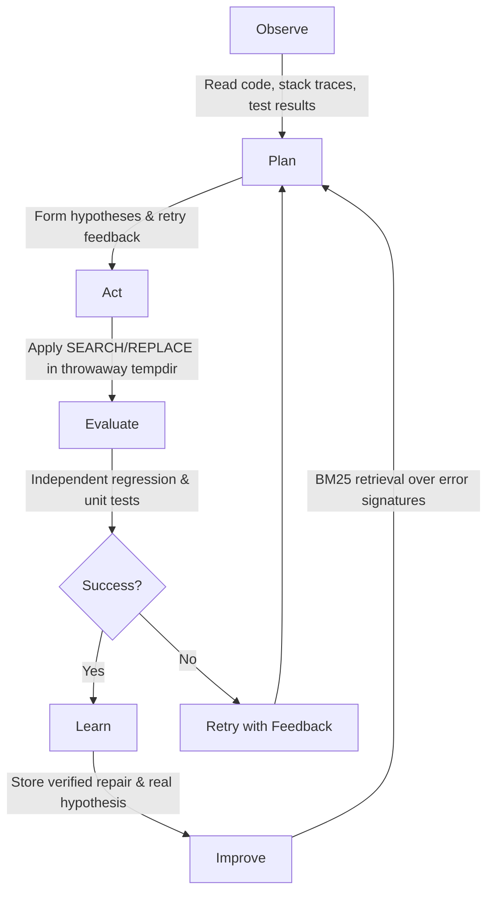

# EvoAgent: A Self-Learning Autonomous Coding Agent

[](https://www.python.org/)
[](LICENSE)
[](https://github.com/PrathameshTawar/self-learning-/actions)
[](#system-architecture)

> **EvoAgent** is an agentic software engineering system with a verified self-learning loop. Unlike static code-generation assistants, EvoAgent observes test failures, plans hypotheses, patches code in isolated disposable environments, independently evaluates test outcomes, and persists lessons into BM25 episodic memory to systematically improve its performance over measurable held-out benchmarks.

---

## Table of Contents
1. [Core Concepts](#core-concepts)
2. [Three Learning Layers](#three-learning-layers)
3. [System Architecture](#system-architecture)
4. [Task State Machine](#task-state-machine)
5. [Hardware-Conscious Design (GTX 1650 / 8GB RAM)](#hardware-conscious-design)
6. [Quickstart Guide](#quickstart-guide)
7. [Running Benchmarks & Held-Out Ablations](#running-benchmarks--held-out-ablations)
8. [Repository Structure](#repository-structure)
9. [Roadmap & Milestones](#roadmap--milestones)

---

## Core Concepts

A self-learning coding agent executes a disciplined lifecycle:



### Core Design Principles
1. **The evaluator is the sole authority**: The coding agent cannot declare its own fix successful. Only independent, reproducible test executions can validate patches.
2. **Reproduction gate**: Tasks where the targeted test already passes pre-patch are rejected as `INVALID_TASK`.
3. **The sandbox runs in throwaway copies**: Tasks execute inside isolated temporary directories (`tempfile.TemporaryDirectory`). Accepted patches and failed attempts never pollute or corrupt the original benchmark or host repository.
4. **Reliable patch format for small models**: Prefers exact `<<<<<<< SEARCH ... ======= ... >>>>>>> REPLACE` blocks over brittle unified diff line counts.
5. **Evidence-based learning**: Improvements are validated on a fixed held-out evaluation set (`benchmarks/split.json`), comparing zero-shot baselines against multi-attempt feedback and episodic memory.
6. **Traceable telemetry**: Every episode records the model version, strategy ID, prompts, tool calls, patches, test diffs, and real model hypotheses.

---

## Three Learning Layers

| Layer | Type | Mechanism | Status |
|---|---|---|---|
| **Layer A** | **Episodic Memory** | Stores failure signatures, root causes, SEARCH/REPLACE patches, and verified outcomes. Injects proven lessons into future planning sessions via Okapi BM25 ranking. | **Implemented & Tested** |
| **Layer B** | **Strategy Optimization** | Genetic evolution of hyperparameters (`prompt_style`, `retrieval_policy`, `retrieval_top_k`, `max_patch_lines`, `temperature`, `enable_multi_file_context`) with a statistical promotion gate. | **Implemented & Tested** |
| **Layer C** | **Model Adaptation** | Curates accepted vs. rejected repair pairs for Supervised Fine-Tuning (SFT) and Direct Preference Optimization (DPO) using LoRA/PEFT when sufficient verified episodes accumulate. | Foundation ready (`export-dataset`) |

---

## System Architecture

```
+-----------------------------------------------------------------------------------+
|                                  USER / CLI                                      |
+-----------------------------------------------------------------------------------+
                                         |
                                         v
+-----------------------------------------------------------------------------------+
|                        Orchestration & Task State Machine                         |
|  - Task lifecycle management (QUEUED -> ANALYZING -> PLANNED -> PATCHING ...)    |
|  - Isolated execution in throwaway temp directories (no repo corruption)          |
|  - Pre-patch test verification gate (rejects pre-passing tests as INVALID_TASK)    |
|  - Retry feedback injection (supplies failed patches and errors to next attempt)  |
+-----------------------------------------------------------------------------------+
        |                           |                           |
        v                           v                           v
+--------------------+      +--------------------+      +--------------------+
|   Analysis Tools   |      |  Pluggable Models  |      |   Memory & Store   |
| - Git inspection   |      | - OpenAI-compatible|      | - Okapi BM25 search|
| - AST symbols (ast)|      |   (Ollama/vLLM)    |      | - SQLite persistent|
| - Code search      |      | - Test Mock        |      | - In-memory test   |
| - SEARCH/REPLACE   |      |   (Heuristic Model)|      |   fixtures         |
+--------------------+      +--------------------+      +--------------------+
                                    |
                                    v
+-----------------------------------------------------------------------------------+
|                            Isolated Execution Sandbox                             |
|  - Strict environment variable allowlist (blocks host secret leaking)             |
|  - Argument vector execution without shell=True                                   |
|  - POSIX resource boundaries on CPU/memory where supported                        |
+-----------------------------------------------------------------------------------+
                                    |
                                    v
+-----------------------------------------------------------------------------------+
|                               Independent Evaluator                               |
|  - Pre-patch test verification (must fail initially)                              |
|  - Post-patch test verification (must pass targeted test)                         |
|  - Regression suite validation (must not break existing tests)                     |
+-----------------------------------------------------------------------------------+
```

---

## Hardware-Conscious Design

Configured specifically for local developer machines (e.g. **NVIDIA GeForce GTX 1650 4 GB VRAM / 8–16 GB RAM**):
- **Zero Heavy Daemons**: Standalone Python architecture using standard library `ast`, SQLite, and subprocess execution.
- **Small Model Optimized**: Tailored for 1.5B–7B coding models (e.g. `qwen2.5-coder:1.5b` via Ollama) using exact SEARCH/REPLACE blocks.
- **Offline Test Mock**: Includes `HeuristicCodingModel` strictly as a fast, deterministic mock for unit tests and CI without needing an LLM.

---

## Quickstart Guide

### 1. Prerequisites
- Python 3.11+ (Python 3.12 recommended)
- Git

### 2. Setup Virtual Environment
```powershell
# In PowerShell:
py -3.12 -m venv .venv
.\.venv\Scripts\Activate.ps1
python -m pip install --upgrade pip
pip install -e .
```

### 3. Run Autonomous Repair
```powershell
# Run repair on a specific benchmark task
python -m evoagent.cli run --task benchmarks/tasks/bug_001_parser/task.json
```

### 4. Launch Live Dashboard
```powershell
# Open browser-based telemetry dashboard
python -m evoagent.cli dashboard --port 8080
```

---

## Running Benchmarks & Held-Out Ablations

### Run Full Benchmark Suite
```powershell
python benchmarks/run_benchmarks.py --split all
```

### Run Train vs. Held-Out Split
```powershell
# Run only train tasks
python benchmarks/run_benchmarks.py --split train

# Run only held-out tasks
python benchmarks/run_benchmarks.py --split held_out
```

### Run 3-Way Self-Learning Ablation Table
Evaluate held-out tasks under 3 controlled experimental conditions to prove learning transfer:
```powershell
python benchmarks/run_benchmarks.py --eval-comparison
```

Outputs the comparative ablation table:
- **Condition A (Zero-Shot Baseline)**: No memory, 1 attempt.
- **Condition B (Feedback Loop)**: No memory, 3 attempts with retry feedback.
- **Condition C (Full Self-Learning)**: Episodic Memory + Multi-attempt retry feedback.

---

## Running Tests & Linting

```powershell
# Run unit & end-to-end tests
pytest -v -p no:deepeval

# Run linter
ruff check src tests benchmarks
```

---

## Repository Structure

```
├── .gitignore
├── LICENSE                       # MIT License
├── pyproject.toml
├── README.md
├── .github/
│   └── workflows/
│       └── ci.yml                # GitHub Actions test matrix (Python 3.11, 3.12)
├── src/
│   └── evoagent/
│       ├── config.py             # Configuration & environment variables
│       ├── cli.py                # Command-line interface
│       ├── domain/               # Domain models & states (Pydantic v2)
│       │   ├── models.py
│       │   └── states.py
│       ├── tools/                # Analysis tools
│       │   ├── git_tools.py      # Git status & diff inspection
│       │   ├── search_tools.py   # Code search & file navigation
│       │   ├── patch_tools.py    # SEARCH/REPLACE & unified diff applicator
│       │   └── test_tools.py     # Pytest execution & error extraction
│       ├── sandbox/              # Process isolation & execution runners
│       │   ├── interface.py
│       │   └── local_runner.py   # Environment allowlisting & process sandbox
│       ├── models/               # Pluggable inference backends
│       │   ├── base.py
│       │   ├── open_model.py     # OpenAI / Ollama / vLLM SEARCH/REPLACE backend
│       │   └── heuristic_model.py# Offline test mock fixture
│       ├── evaluation/           # Independent evaluation authority
│       │   ├── evaluator.py
│       │   └── metrics.py
│       ├── memory/               # Episodic memory & retrieval (Layer A)
│       │   ├── bm25.py           # Okapi BM25 ranking algorithm
│       │   ├── schemas.py
│       │   ├── store.py          # SQLite & in-memory stores
│       │   └── retrieval.py      # Experience retriever with policies
│       ├── intelligence/         # AST symbol intelligence
│       │   ├── ast_symbols.py    # Python AST symbol extractor
│       │   ├── symbol_graph.py   # Cross-file symbol reference graph
│       │   └── context_builder.py# Multi-file AST context assembly
│       ├── dashboard/            # Local web telemetry dashboard
│       │   ├── server.py         # HTTP API & static server
│       │   └── static/
│       │       └── index.html    # Single-page monitoring UI
│       ├── orchestration/        # Orchestration engine
│       │   ├── planner.py        # Task planner with retry feedback & genes
│       │   ├── repair_agent.py   # Candidate proposal coordinator
│       │   └── state_machine.py  # FSM lifecycle in throwaway tempdirs
│       └── learning/             # Self-learning systems (Layers B & C)
│           ├── dataset.py        # SFT / DPO training split curator
│           ├── genetic.py        # Strategy chromosome & genetic operators
│           ├── evolution.py      # Tournament & generational strategy evaluation
│           └── registry.py       # Versioned strategy registry with promotion gate
├── benchmarks/                   # Benchmark suite & evaluation splits
│   ├── split.json                # Fixed train vs. held-out task partition
│   ├── run_benchmarks.py         # Multi-condition evaluation runner
│   └── tasks/
│       ├── bug_001_parser/       # [train] IndexError on empty input
│       ├── bug_002_multifile/    # [train] ZeroDivisionError with cross-file context
│       ├── bug_003_binary_search/# [train] Off-by-one boundary index defect
│       ├── bug_004_dict_merge/   # [held-out] NoneType attribute error in dict merge
│       ├── bug_005_levenshtein/  # [held-out] Dynamic programming boundary condition
│       └── bug_006_rate_limiter/ # [held-out] Sliding window filter inequality bug
└── tests/                        # Comprehensive unit & E2E tests
    ├── unit/
    └── e2e/
```

---

## Roadmap & Milestones

- [x] **Milestone 1: Controlled Repair Loop & Foundation** (Task runner, sandbox execution, patch application, independent evaluation, episodic memory).
- [x] **Milestone 2: Multi-File Context & AST Symbol Navigation** (Python AST symbol extraction, dependency graph, cross-file reference assembly).
- [x] **Milestone 3: Strategy Optimization Engine** (Genetic strategy evolution, prompt exploration, statistical promotion gate).
- [ ] **Milestone 4: PEFT/Q-LoRA 4-bit Fine-Tuning** (Curated dataset export, adapter training on GeForce GTX 1650).
- [ ] **Milestone 5: Production Deployment & Remote Workers** (FastAPI API, PostgreSQL/pgvector, Redis queues).
