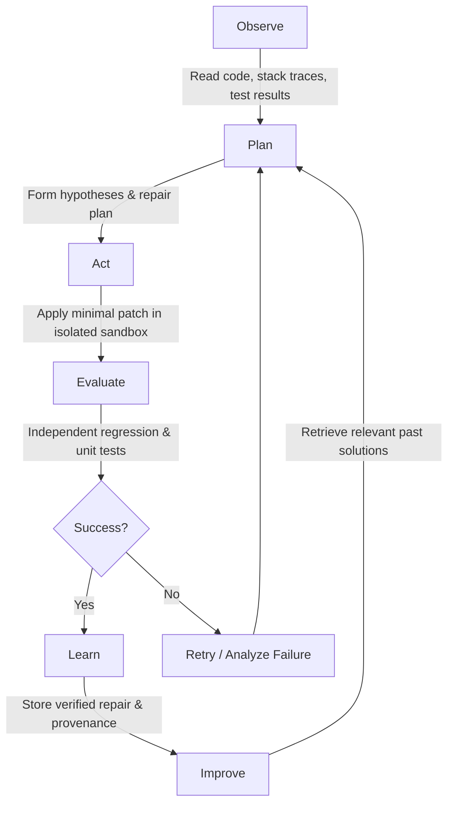

# EvoAgent: A Self-Learning Autonomous Coding Agent

[](https://www.python.org/)
[](LICENSE)
[](#system-architecture)

> **EvoAgent** is an agentic software engineering system with a controlled learning loop. Unlike basic code-generation chatbots, EvoAgent observes failures, plans hypotheses, patches code in isolated sandboxes, independently evaluates test outcomes, and persists lessons into memory to systematically improve its future performance over measurable benchmarks.

---

## Table of Contents
1. [Core Concepts](#core-concepts)
2. [Three Learning Layers](#three-learning-layers)
3. [System Architecture](#system-architecture)
4. [Task State Machine](#task-state-machine)
5. [Hardware-Conscious Design (GTX 1650 / 8GB RAM)](#hardware-conscious-design)
6. [Quickstart Guide](#quickstart-guide)
7. [Running Benchmarks & Tests](#running-benchmarks--tests)
8. [Repository Structure](#repository-structure)
9. [Roadmap & Milestones](#roadmap--milestones)

---

## Core Concepts

A self-learning coding agent executes a disciplined lifecycle:



### Core Design Principles
1. **The evaluator is the authority**: The coding agent cannot declare its own fix successful. Only independent, reproducible test executions can validate patches.
2. **The sandbox is untrusted**: Generated code and test dependencies run with strict execution timeouts, process limits, and clean repository snapshots.
3. **Evidence-based learning**: Every claimed improvement must survive a fixed held-out evaluation set. Memorization is not learning.
4. **Isolated updates**: Model weights and policy changes are never modified blindly from a single task. Offline evaluation and explicit promotion gates are enforced.
5. **Traceable telemetry**: Every task records the model version, prompts, tool calls, patches, test diffs, and final decisions.

---

## Three Learning Layers

| Layer | Type | Mechanism | Update Frequency |
|---|---|---|---|
| **Layer A** | **Episodic Memory** | Stores error signatures, root causes, patches, and verified outcomes. Injects proven lessons into future planning sessions. | After every evaluated task |
| **Layer B** | **Strategy Optimization** | Compares alternative planning prompts, search heuristics, and repair policies over fixed benchmark suites. | After batches of experiments |
| **Layer C** | **Model Adaptation** | Curates accepted vs. rejected repair pairs for Supervised Fine-Tuning (SFT) and Direct Preference Optimization (DPO) using LoRA/PEFT. | Offline training runs |

---

## System Architecture

```
+-----------------------------------------------------------------------------------+
|                                  USER / CLI                                      |
+-----------------------------------------------------------------------------------+
                                         |
                                         v
+-----------------------------------------------------------------------------------+
|                        Orchestration & Task State Machine                         |
|  - Task lifecycle management (QUEUED -> ANALYZING -> PLANNED -> PATCHING ...)    |
|  - Budget enforcement (max tool calls, max retries, max diff size, wall timeouts) |
+-----------------------------------------------------------------------------------+
        |                           |                           |
        v                           v                           v
+--------------------+      +--------------------+      +--------------------+
|   Analysis Tools   |      |  Pluggable Models  |      |   Memory & Store   |
| - Git inspection   |      | - Local Heuristic  |      | - Episodic records |
| - Code search      |      | - Ollama / vLLM    |      | - Failure signature|
| - Symbol indexing  |      | - OpenAI-compatible|      | - SQLite / pgvector|
+--------------------+      +--------------------+      +--------------------+
                                    |
                                    v
+-----------------------------------------------------------------------------------+
|                            Isolated Execution Sandbox                             |
|  - Disposable process runner (subprocesses with timeouts and clean environments)   |
|  - Patch validation & rollback protection                                         |
+-----------------------------------------------------------------------------------+
                                    |
                                    v
+-----------------------------------------------------------------------------------+
|                               Independent Evaluator                               |
|  - Pre-patch test verification (must fail initially)                              |
|  - Post-patch test verification (must pass targeted test)                         |
|  - Regression suite validation (must not break existing tests)                     |
+-----------------------------------------------------------------------------------+
                                    |
                                    v
+-----------------------------------------------------------------------------------+
|                             Continuous Learning Engine                            |
|  - Provenance-tracked episode curation                                            |
|  - Dataset preparation for SFT (prompt-response) and DPO (accepted/rejected pairs)|
|  - Strategy & prompt evaluation across benchmarks                                 |
+-----------------------------------------------------------------------------------+
```

---

## Task State Machine

EvoAgent executes tasks through an explicit, auditable state machine:

```
[QUEUED] 
   |
   v
[ANALYZING] ------------> [FAILED (Unresolvable)]
   |
   v
[PLANNED]
   |
   v
[PATCHING]
   |
   v
[EVALUATING]
   |
   +---> [SUCCEEDED] --------> [LEARNING_REVIEW] ------> [COMPLETED]
   |
   +---> [RETRYABLE_FAILURE] -> [ANALYZING] (if attempts < max_budget)
   |
   +---> [FAILED] (budget exhausted)
```

---

## Hardware-Conscious Design

Configured specifically for local Windows machines with **NVIDIA GeForce GTX 1650 (4 GB VRAM)** and **8 GB System RAM**:
- **Lightweight by default**: Fast startup without mandatory Docker daemons or heavy background services for initial milestones.
- **Subprocess Isolation**: Process-level sandboxing with strict timeouts and resource limits on Windows/PowerShell.
- **Quantized / Small Model Support**: Out-of-the-box support for lightweight local models (e.g. Qwen2.5-Coder 1.5B via Ollama or GGUF) and deterministic heuristic models for automated benchmark verification.
- **Resource Protection**: Memory-efficient SQLite episodic store that scales to PostgreSQL + pgvector when deployed on servers.

---

## Quickstart Guide

### 1. Prerequisites
- Windows 10/11 with PowerShell
- Python 3.11+ (Python 3.12 recommended)
- Git

### 2. Setup Virtual Environment
```powershell
# In PowerShell:
py -3.12 -m venv .venv
.\.venv\Scripts\Activate.ps1
python -m pip install --upgrade pip
pip install -e .
```

### 3. Run the Demonstration Repair Loop
```powershell
# Run the built-in bug repair demonstration
python -m evoagent.cli run --task benchmarks/tasks/bug_001_parser/task.json
```

### 4. Run Benchmarks
```powershell
python benchmarks/run_benchmarks.py
```

---

## Running Benchmarks & Tests

```powershell
# Run unit and end-to-end tests
pytest -q
```

---

## Repository Structure

```
├── .gitignore
├── pyproject.toml
├── requirements.txt
├── .env.example
├── README.md
├── src/
│   └── evoagent/
│       ├── config.py             # Configuration & environment variables
│       ├── cli.py                # Command-line interface
│       ├── domain/               # Domain models & state machine definitions
│       │   ├── models.py
│       │   └── states.py
│       ├── tools/                # Git, search, patch, and test tools
│       │   ├── git_tools.py
│       │   ├── search_tools.py
│       │   ├── patch_tools.py
│       │   └── test_tools.py
│       ├── sandbox/              # Process isolation & execution runners
│       │   ├── interface.py
│       │   └── local_runner.py
│       ├── models/               # Pluggable model backends (Heuristic, Ollama, API)
│       │   ├── base.py
│       │   ├── heuristic_model.py
│       │   └── open_model.py
│       ├── evaluation/           # Independent evaluator & benchmark metrics
│       │   ├── evaluator.py
│       │   └── metrics.py
│       ├── memory/               # Episodic experience memory & retrieval
│       │   ├── schemas.py
│       │   ├── store.py
│       │   └── retrieval.py
│       ├── orchestration/        # Planner, repair agent, & task controller
│       │   ├── planner.py
│       │   ├── repair_agent.py
│       │   └── state_machine.py
│       └── learning/             # Dataset curation, strategy tuning, & experiments
│           ├── dataset.py
│           ├── strategy.py
│           └── experiments.py
├── benchmarks/                   # Seeded tasks & reproducible benchmarks
│   ├── tasks/
│   │   └── bug_001_parser/
│   └── run_benchmarks.py
├── tests/                        # Comprehensive unit & E2E tests
│   ├── unit/
│   └── e2e/
└── training/                     # Dataset export & LoRA fine-tuning scripts
    ├── prepare_dataset.py
    └── train_lora.py
```

---

## Roadmap & Milestones

- [x] **Milestone 1: Controlled Repair Loop & Foundation** (Task runner, sandbox execution, patch application, independent evaluation, episodic memory).
- [ ] **Milestone 2: Multi-File Context & AST Symbol Navigation** (Tree-sitter integration, cross-file references).
- [ ] **Milestone 3: Strategy Optimization Engine** (Automated prompt exploration, genetic strategy mutation).
- [ ] **Milestone 4: PEFT/Q-LoRA 4-bit Fine-Tuning** (Curated dataset export, adapter training on GeForce GTX 1650).
- [ ] **Milestone 5: Production Deployment & Remote Workers** (FastAPI API, PostgreSQL/pgvector, Redis queues).
